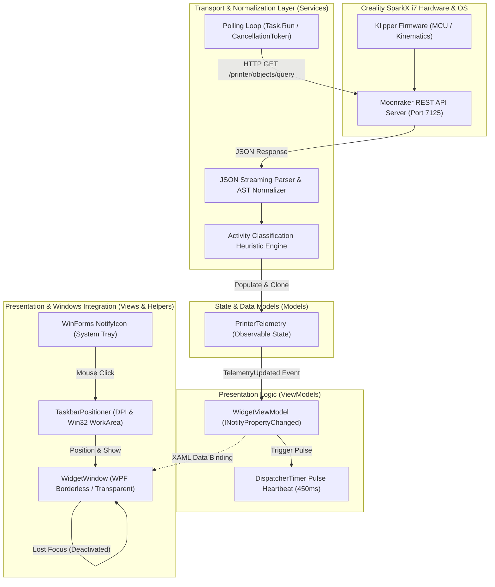
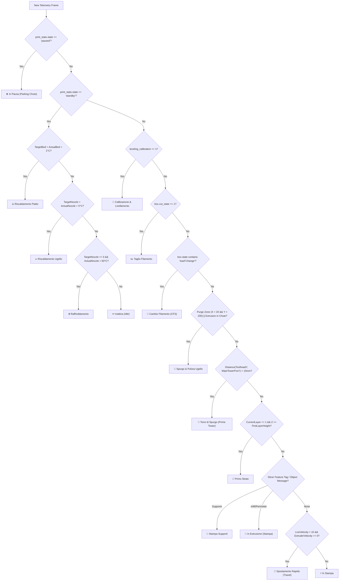

# Creality SparkX i7 Flyout Widget

A lightweight, non-invasive, high-precision Windows System Tray dashboard for real-time telemetry extraction, operational state classification, and sensor monitoring for the **Creality SparkX i7** (and compatible Creality OS / Klipper / Moonraker-based 3D printers).

---

## 1. Abstract & Executive Overview

Modern high-speed additive manufacturing machines, such as the **Creality SparkX i7**, operate under closed-loop motion control systems driven by Klipper firmware and exposed via Moonraker API layers. Monitoring machine status typically requires maintaining heavyweight browser dashboards (e.g., Fluidd or Mainsail), which consume substantial memory and lack native operating system integration.

The **Creality SparkX Widget** solves this problem by providing an ultra-lightweight, hardware-accelerated Windows Presentation Foundation (WPF) System Tray flyout. It implements a non-interfering, read-only telemetry engine that polls Moonraker endpoints, normalizes hardware states, and evaluates a heuristic classification state machine to reconstruct detailed real-time printing phases (e.g., thermal stabilization, nozzle purging, prime tower compensation, extrusion modes, and multi-material CFS swaps).

### Core Engineering Principles
- **Zero Interference (100% Read-Only):** The widget issues solely non-mutating HTTP `GET` queries. It contains zero print control endpoints (`pause`, `resume`, `cancel`, or arbitrary G-code execution), guaranteeing absolute safety and preventing any interference with ongoing print jobs.
- **Micro-Footprint System Integration:** Runs silently in the Windows notification area with single-instance kernel Mutex protection, automatic taskbar edge docking with multi-monitor DPI scaling, and instantaneous blur auto-hide.
- **Minimalist High-Density HMI:** Designed according to modern dark grayscale UI standards (`#111215` palette), featuring frameless/borderless metric layouts, high-contrast white typographic readouts, distinct functional color accents, and an animated visual heartbeat indicator triggered upon every successful polling packet.

---

## 2. System Architecture & Component Topology

The system is engineered in **C# 12 / .NET 8 (Windows Desktop)** following the **Model-View-ViewModel (MVVM)** architectural design pattern, ensuring complete decoupling between network transport routines, state normalization logic, and the WPF composition engine.



### Component Hierarchy
- **`App.xaml` / `App.xaml.cs`:** Application entry point, single-instance named Mutex orchestration (`CrealitySparkXWidget_SingleInstance_Mutex`), System Tray `NotifyIcon` lifecycle, context menu instantiation, and global unhandled exception trapping.
- **`Services/MoonrakerService.cs`:** Asynchronous network transport engine managing HTTP keep-alive sockets, Moonraker query construction, AST JSON deserialization, G-code metadata caching, and printer activity classification.
- **`Services/PrinterManager.cs`:** Abstraction facade delegating telemetry streams between the live Moonraker client and an offline simulation provider (`DemoPrinterService.cs`).
- **`Models/PrinterTelemetry.cs`:** Thread-safe observable domain model capturing temperatures, motion coordinates, velocities, fan percentages, and multi-color CFS spool metrics.
- **`ViewModels/WidgetViewModel.cs`:** Reactive presentation mediator providing formatted strings, color converters, command implementations, and the visual polling pulse dispatch timer.
- **`Views/WidgetWindow.xaml` / `WidgetWindow.xaml.cs`:** WPF window utilizing hardware-accelerated composition, custom control templates, and smooth storyboard animations for the polling indicator.
- **`Helpers/TaskbarPositioner.cs`:** Screen geometry calculator resolving physical monitor bounds, per-monitor DPI scaling, and dynamic alignment above taskbars regardless of edge placement (Bottom, Top, Left, Right).

---

## 3. Hardware & Protocol Interfacing

### 3.1. Moonraker Object Query Pipeline
Communication with the Creality SparkX i7 is conducted via HTTP REST transactions targeting port `7125`. The engine constructs a comprehensive query payload to retrieve 22 distinct Klipper printer objects in a single round-trip:

$$\text{GET } \mathtt{http://\langle Host\rangle:7125/printer/objects/query?\langle QueryString\rangle\&\_=\langle Timestamp\rangle}$$

The `_` query parameter injects a millisecond-precision Unix timestamp to defeat intermediate proxy caching and force fresh evaluation on the printer's HTTP daemon.

#### Table 1: Queried Moonraker Objects & Normalized Parameters
| Klipper Object | Extracted JSON Attributes | Logical Telemetry Target |
| :--- | :--- | :--- |
| `print_stats` | `state`, `filename`, `print_duration`, `z_pos`, `info` | Print lifecycle status, active file, elapsed time, current layer |
| `virtual_sdcard` | `progress`, `file_position` | Overall print percentage completion ($0.0 \dots 1.0$) |
| `display_status` | `progress`, `message` | Slicer-generated LCD messages, progress fallback |
| `extruder` | `temperature`, `target` | Hotend thermal readings ($^\circ\text{C}$) |
| `heater_bed` | `temperature`, `target` | Heated build plate thermal readings ($^\circ\text{C}$) |
| `toolhead` | `position`, `estimated_print_time` | Absolute kinematic toolhead coordinates $(X, Y, Z)$ |
| `gcode_move` | `gcode_position`, `speed`, `speed_factor` | Commanded toolhead position and active feedrate |
| `motion_report` | `live_velocity`, `live_extruder_velocity` | Real-time instantaneous kinematic toolhead & extruder velocities ($\text{mm/s}$) |
| `output_pin fan0` | `value` | Part cooling fan PWM duty cycle ($0.0 \dots 1.0 \rightarrow 0 \dots 100\%$) |
| `output_pin fanp0` | `value` | Auxiliary enclosure cooling fan PWM duty cycle |
| `fan_feedback` | `fan1_speed` | Physical cooling fan tachometer signal (RPM) |
| `temperature_sensor mcu_temp`| `temperature` | Mainboard micro-controller unit (MCU) temperature ($^\circ\text{C}$) |
| `temperature_sensor chamber` | `temperature` | Internal build chamber ambient temperature ($^\circ\text{C}$) |
| `box` | `cut_state`, `state`, `T1`, `same_material` | Creality Filament System (CFS) multi-material spool slots & blade status |
| `heaters` | `available_heaters` | Enumeration of active thermal control loops |
| `pause_resume` | `is_paused` | Hardware pause state indicator |
| `exclude_object` | `current_object` | Slicer feature metadata tag (e.g., infill, wall, support) |
| `idle_timeout` | `state` | Host power management state (`Ready`, `Idle`, `Printing`) |

### 3.2. Asynchronous Metadata Extraction Pipeline
When a print job initiates and the active filename changes, the engine asynchronously invokes the `/server/files/metadata` endpoint:

$$\text{GET } \mathtt{http://\langle Host\rangle:7125/server/files/metadata?filename=\langle EscapedFilename\rangle}$$

The resulting AST yields critical structural properties of the sliced G-code:
1. `object_height` ($H_{obj}$): Total physical height of the printed volume in millimeters.
2. `layer_height` ($h_l$) / `first_layer_height` ($h_0$): Sliced layer thickness.
3. `layer_count` ($N_{layers}$): Total layer count declared by the slicer.
4. `wipe_tower_posy`: $Y$-axis coordinate of the multi-material purge tower.

If `layer_count` is omitted by the slicer, the engine calculates the theoretical layer count dynamically:

$$N_{total} = \begin{cases} 
N_{slicer} & \text{if } N_{slicer} > 0 \\ 
\left\lceil \frac{H_{obj}}{h_l} \right\rceil & \text{if } H_{obj} > 0 \land h_l > 0.05 \\ 
0 & \text{otherwise} 
\end{cases}$$

Similarly, the current layer index is computed from real-time $Z$-axis elevation:

$$L_{current} = \min\left(N_{total}, \max\left(1, \left\lfloor \frac{Z_{actual}}{h_l} + 0.5 \right\rfloor\right)\right)$$

---

## 4. Operational State Classifier & Heuristic Engine

A major deficiency in standard Klipper frontends is the simplistic display of generic states (`printing`, `standby`). The Creality SparkX Widget implements an advanced multi-variable decision heuristic (`DetermineDetailedActivity`) that evaluates 13 distinct sensor and kinematic variables to pinpoint the precise physical operation being executed by the printer.



### 4.1. Resolution of the Sticky Pause Bug
Creality OS firmware exhibits a known anomaly where `pause_resume.is_paused` remains permanently `true` after certain resume cycles or multi-material retries. The heuristic engine bypasses this bug by strictly validating `print_stats.state`:

$$\text{IsPaused} \iff (\mathtt{print\_stats.state} == \text{"paused"})$$

If `print_stats.state == "printing"`, any sticky `is_paused` flag is discarded, preventing erroneous pause reporting while the printer is extruding.

### 4.2. Purge & Chute Detection Heuristics
During multi-color transitions and pre-print wiping, the Creality SparkX i7 parks the toolhead over the rear-left waste chute. The engine detects this condition via spatial bounding and extrusion velocity:

$$\text{IsPurging} \iff \left( (X < 25.0 \land Y > 200.0) \lor \mathtt{slicer\_msg} \ni \text{"purge"} \right) \land \dot{E} > 0$$

### 4.3. Prime Tower Compensation Detection
When printing multi-material components with a CFS unit, a wipe tower is deposited to equalize nozzle pressure. The engine monitors the proximity between the instantaneous toolhead position and the G-code's declared wipe tower coordinates:

$$\text{IsPrimeTower} \iff |Y_{toolhead} - Y_{wipe\_tower}| < 15.0\,\text{mm} \land \dot{E} > 0.5\,\text{mm/s}$$

---

## 5. Multi-Color CFS (Color Filament System) Protocol Decoding

The Creality SparkX i7 integrates a 4-slot automated material unit (CFS). Creality encodes the filament metadata within the `box` object using proprietary arrays and non-standard hexadecimal notations.

### 5.1. The `same_material` Array Structure
The `box.same_material` JSON array contains tuples for each physical spool slot:

```json
[
  ["000001", "0FF6E1A", ["T1A"], "Hyper PLA"],
  ["000002", "01E293B", ["T1B"], "PETG"],
  ["000003", "0E2E8F0", ["T1C"], "PLA-CF"],
  ["000004", "0EF4444", ["T1D"], "TPU 95A"]
]
```

### 5.2. Hexadecimal Color Sanitization Algorithm
Creality OS prefixes 24-bit RGB hex values with an extraneous leading `0` or channel indicator (e.g., `0FF6E1A` represents `#FF6E1A`). The parser normalizes these strings into standard HTML/WPF 6-digit hex representations:

```csharp
private static string CleanCrealityColorHex(string? raw)
{
    if (string.IsNullOrWhiteSpace(raw) || raw == "-1" || raw == "None") 
        return "#64748B"; // Neutral slate fallback
    
    string cleaned = raw.Trim().TrimStart('#');
    
    // Normal 6-character hex
    if (cleaned.Length == 6) return $"#{cleaned}";
    
    // Creality 7-character hex with leading '0' prefix: "0FF6E1A" -> "#FF6E1A"
    if (cleaned.Length == 7 && (cleaned.StartsWith("0") || cleaned.StartsWith("F"))) 
        return $"#{cleaned[1..]}";
    
    // 8-character ARGB: take last 6 characters
    if (cleaned.Length >= 8) 
        return $"#{cleaned[^6..]}";
    
    return "#64748B";
}
```

### 5.3. Active Spool Slot Resolution
The currently loaded spool is identified by extracting the active channel letter from `box.T1.filament` (e.g., `"B"`). The parser matches this letter against the slot code:

$$\text{Slot } i \text{ IsActive} \iff \mathtt{slotCode} == \mathtt{"T1"} + \text{activeFilamentLetter}$$

Active slots are visually distinguished in the HMI with a checkmark glyph (`✓`), an emerald green label (`IN USO`), and an active border highlight.

---

## 6. Sensor Telemetry & Physical Metrics

### 6.1. Thermal Management & Dynamic Sensor Fallback
The widget extracts four independent thermal zones:
1. **Extruder / Hotend:** Actual vs. Target temperature with proportional thermal bar ($0 \dots 300^\circ\text{C}$).
2. **Heated Bed:** Actual vs. Target temperature with thermal bar ($0 \dots 110^\circ\text{C}$).
3. **Chamber / MCU Fallback:** Industrial 3D printers prioritize chamber ambient temperature for engineering filaments (ABS, ASA, PA-CF). If an internal chamber sensor (`temperature_sensor chamber` or `box`) is absent or reads zero, the widget automatically falls back to monitoring the mainboard processor temperature (`temperature_sensor mcu_temp`), adjusting tile titles and descriptions dynamically:

```csharp
public string SecondarySensorTitle =>
    (ChamberTemperature.HasValue && ChamberTemperature.Value > 0) ? "🏠 Camera" :
    (McuTemperature.HasValue && McuTemperature.Value > 0) ? "💻 MCU" : "🏠 Camera";

public string SecondarySensorValue =>
    (ChamberTemperature.HasValue && ChamberTemperature.Value > 0) ? $"{ChamberTemperature.Value:F1} °C" :
    (McuTemperature.HasValue && McuTemperature.Value > 0) ? $"{McuTemperature.Value:F1} °C" : "-- °C";

public string SecondarySensorSubtext =>
    (ChamberTemperature.HasValue && ChamberTemperature.Value > 0) ? "Temperatura box" :
    (McuTemperature.HasValue && McuTemperature.Value > 0) ? "Scheda madre" : "Non rilevato";
```

### 6.2. Part Fan Reconciliation vs. Heatsink Tachometer
In Creality Print and Creality OS, users often observe discrepancies between part cooling percentages and fan speeds. Creality firmware assigns:
- `output_pin fan0`: Model part cooling fan (PWM $0 \dots 100\%$).
- `fan_feedback.fan0_speed`: Cold-end heatsink fan running continuously at ~12,000 RPM.
- `fan_feedback.fan1_speed`: Part cooling fan physical tachometer (RPM).

The widget displays the true **model part cooling fan percentage** (`FanSpeedPercent%`), precisely matching the reading shown on Creality Print and the machine's front-panel display.

---

## 7. Windows Integration & UI/UX Design System

### 7.1. Dynamic Taskbar Edge Docking
The `TaskbarPositioner` helper calculates flyout coordinates on the fly, supporting arbitrary Windows taskbar positions (Bottom, Top, Left, Right) and multi-monitor setups with disparate DPI scaling factors.

$$\text{WorkArea}_{DIP} = \frac{\text{PhysicalPixels}}{DPI / 96.0}$$

```csharp
// Screen bounds clamped with margin
if (taskbarAtBottom)
{
    targetTop = workAreaBottom - windowHeight - margin;
    targetLeft = cursorX - (windowWidth / 2.0);
}
// Automatically clamped to ensure 100% on-screen visibility
targetLeft = Math.Clamp(targetLeft, workAreaLeft + margin, workAreaRight - windowWidth - margin);
targetTop  = Math.Clamp(targetTop, workAreaTop + margin, workAreaBottom - windowHeight - margin);
```

### 7.2. Transient Deactivation & Auto-Hide
In accordance with modern Windows widget conventions (e.g., Windows 11 Calendar / Network flyouts), the window registers a `Deactivated` event listener:

```csharp
private void Window_Deactivated(object? sender, EventArgs e)
{
    if (!_isExplicitClosing && IsVisible)
    {
        Hide();
    }
}
```

The flyout opens smoothly upon clicking the tray icon and dismisses automatically as soon as the user clicks anywhere else on their desktop.

### 7.3. Minimalist Dark Office Visual Language
- **True Dark Grayscale Palette:** Solid `#111215` outer container with crisp hairline borders (`#24262B`). Solid gray card backgrounds have been eliminated (`Background="Transparent"`), allowing information to float naturally on a unified, dark slate background.
- **Borderless Metric Hierarchy:** Inner sensor tiles and progress panels feature `BorderThickness="0"`, structured by subtle separators (`#202227`) and whitespace.
- **High-Contrast Typographic Readouts:** Primary telemetry metrics (Progress percentage, ETA, Temperatures, Fan percentage, Layer, Speed) are rendered in crisp `#FFFFFF` bold typography, while technical micro-labels utilize muted neutral grays (`#6B7280`).
- **Functional Color Accents:**
  - Hotend / Nozzle: Coral Red (`#F87171` text, `#EF4444` gauge bar).
  - Heated Bed: Amber (`#FBBF24` text, `#F59E0B` gauge bar).
  - MCU / Chamber: Cyan (`#38BDF8`).
  - Cooling Fan: Mint / Emerald (`#34D399`).
  - Active Operation: Emerald Green (`#10B981`) or dynamic phase tint.

### 7.4. Real-Time Polling Heartbeat Indicator
To provide visual confirmation that live data has been parsed, the header contains a reactive synchronization indicator (`🔄`):
1. **Pulse Dispatcher:** Upon receiving a new telemetry packet, `WidgetViewModel.TriggerPollPulse()` sets `IsPollPulse = true` for exactly 450 ms via a dedicated `DispatcherTimer`.
2. **Smooth Rotation Storyboard:** A XAML `DataTrigger` animates the icon's `RotateTransform.Angle` by $180^\circ$ over 350 ms using an ease-out quadratic function.
3. **Luminance Jump:** The icon's opacity jumps from $0.35$ (dim gray `#4B5563`) to $1.0$ (vivid emerald green `#10B981`) during the pulse, accompanied by an instantaneous update of the `LastUpdatedShort` timestamp (`HH:mm:ss`).

---

## 8. Directory & File Manifest

```
CrealitySparkXWidget/
├── CrealitySparkXWidget.slnx          # Modern Visual Studio Solution XML
├── CrealitySparkXWidget.csproj        # .NET 8.0-windows Project Configuration
├── AssemblyInfo.cs                    # WPF ResourceDictionary & Assembly Attributes
├── App.xaml / App.xaml.cs             # Application Lifecycle, Single-Instance Mutex & NotifyIcon
├── README.md                          # Technical-Scientific Documentation
├── Converters/
│   └── Converters.cs                  # Value-to-brush, active-border, and visibility converters
├── Helpers/
│   ├── IconHelper.cs                  # Dynamic System.Drawing GDI+ 3D printer tray icon generator
│   └── TaskbarPositioner.cs           # Win32 screen geometry & DPI-aware taskbar anchoring
├── Models/
│   ├── AppSettings.cs                 # Local configuration model (Host, Port, Refresh Interval)
│   └── PrinterTelemetry.cs            # Complete observable domain model for Klipper metrics
├── Services/
│   ├── IPrinterService.cs             # Generic printer telemetry interface contract
│   ├── MoonrakerService.cs            # Moonraker HTTP REST transport, JSON parser & state heuristics
│   ├── DemoPrinterService.cs          # Simulated telemetry generator for offline demonstration
│   ├── PrinterManager.cs              # Service dispatcher and lifecycle coordinator
│   ├── SettingsService.cs             # JSON serialization engine for AppData settings storage
│   └── StartupManager.cs              # Windows Registry run-at-startup integration helper
├── ViewModels/
│   ├── RelayCommand.cs                # Standard ICommand implementation for MVVM bindings
│   ├── ViewModelBase.cs               # INotifyPropertyChanged base implementation
│   └── WidgetViewModel.cs             # Master view model coordinating UI state, bindings & timers
└── Views/
    ├── WidgetWindow.xaml              # High-density borderless dark office XAML layout
    └── WidgetWindow.xaml.cs           # Window code-behind (drag handling, deactivation auto-hide)
```

---

## 9. Compilation & Deployment

### 9.1. Prerequisites
- **Operating System:** Windows 10 (Build 19041+) or Windows 11 (64-bit).
- **SDK:** [.NET 8.0 SDK](https://dotnet.microsoft.com/download/dotnet/8.0) (Version 8.0.100 or higher).

### 9.2. Building in Release Mode
Always build the application using the `Release` configuration to enable compiler optimizations, dead code elimination, and ready-to-run image generation:

```powershell
# Restore NuGet dependencies
dotnet restore CrealitySparkXWidget.slnx

# Compile in Release mode
dotnet build CrealitySparkXWidget.slnx -c Release
```

The compiled binaries are placed in:
```
bin\Release\net8.0-windows\
```

### 9.3. Packaging Portable Distribution Bundle
To produce a portable standalone archive for deployment:

```powershell
Compress-Archive -Path "bin\Release\net8.0-windows\*" -DestinationPath "bin\Release\v1.0.0.zip" -Force
```

---

## 10. Configuration & Local State

The application persists user preferences locally in the Windows user profile directory:
```
%APPDATA%\CrealitySparkXWidget\settings.json
```

### Configuration Schema (`settings.json`)
```json
{
  "PrinterHost": "192.168.78.50",
  "Port": 7125,
  "RefreshIntervalSeconds": 2,
  "AutoConnectOnStartup": true,
  "StartWithWindows": false,
  "CustomWebDashboardUrl": "",
  "EnableDemoMode": false
}
```

- `PrinterHost`: IPv4 address or hostname of the Creality SparkX i7.
- `Port`: Moonraker HTTP REST port (default: `7125`).
- `RefreshIntervalSeconds`: Polling interval in seconds (minimum: `1`).
- `AutoConnectOnStartup`: Automatically initiates background polling upon application launch.
- `StartWithWindows`: Registers an entry in `HKCU\Software\Microsoft\Windows\CurrentVersion\Run`.
- `EnableDemoMode`: Simulates live print cycles with multi-material CFS swaps for testing without physical hardware.

---

## 11. Verification & Logging

Diagnostic telemetry logs are persisted at:
```
%APPDATA%\CrealitySparkXWidget\app.log
```

Log records output structured, millisecond-timestamped telemetry frames:
```text
[13:44:17.743] UI Telemetry: Activity=⚡ In Stampa, Layer=26 / 816, Z=3.20 mm, Speed=11 mm/s, Fan=80%, Sensor=💻 MCU:52.0 °C, Nozzle=209.2°C, Bed=66.4°C, Prog=8%
[13:44:23.054] UI Telemetry: Activity=⚡ In Stampa, Layer=26 / 816, Z=3.60 mm, Speed=200 mm/s, Fan=80%, Sensor=💻 MCU:51.7 °C, Nozzle=210.6°C, Bed=64.7°C, Prog=8%
[13:44:28.332] UI Telemetry: Activity=🧵 In Estrusione (Stampa), Layer=26 / 816, Z=3.20 mm, Speed=32 mm/s, Fan=80%, Sensor=💻 MCU:51.4 °C, Nozzle=211.2°C, Bed=64.3°C, Prog=8%
```

---

## 12. License

This project is released under the **MIT License**. You are free to modify, distribute, and integrate this software in private or commercial environments.
